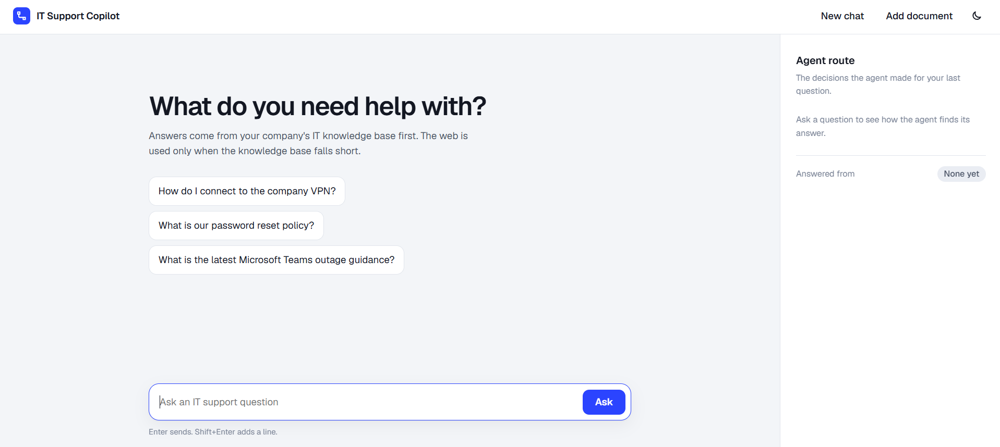
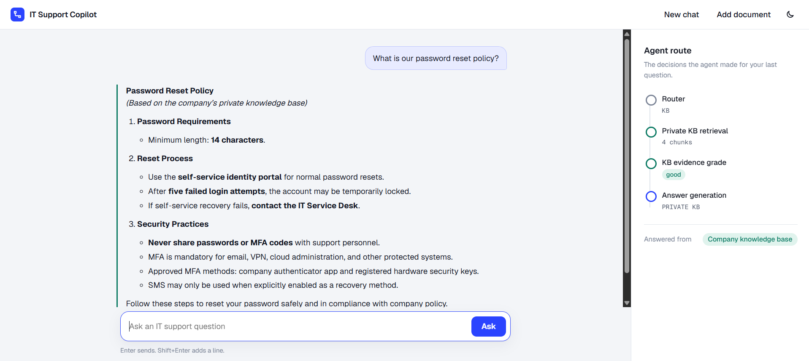

# Enterprise IT Support Agentic RAG Copilot

An end-to-end **Forward Deployed Engineer (FDE) project** that turns a notebook-style Agentic RAG workflow into a deployable internal product using **LangGraph, FastAPI, Pinecone, Groq, Gemini, Tavily, HTML, CSS, and JavaScript**.

Employees ask IT questions in plain language. The agent answers from the company's private knowledge base first, uses the public web only when that evidence is weak, and shows every decision it made along the way.

## Screenshots

**Start screen** with example questions and the (still empty) agent route panel:



**Answer from the private knowledge base**, rendered as formatted text, with the agent's route (router, retrieval, evidence grade, answer) and the source on the right:



The interface follows your system's light or dark setting, and the moon button in the header switches it manually.

---

## 1. Business Problem

### Customer
**NovaRetail**, a fictional 3,000-employee retail company.

### Problem
The internal IT team maintains many documents: VPN instructions, password rules, MFA policy, software installation rules, laptop troubleshooting guides, and service-desk runbooks.

Employees still create repetitive support tickets because:

- They do not know where the correct document is.
- Traditional keyword search returns too many results.
- A normal chatbot may hallucinate an answer.
- Internal documents can be incomplete or outdated.
- Some questions require current vendor information from the public web.

### Example
An employee asks:

> **“How do I connect to the company VPN from home?”**

The answer exists in the private company KB, so the system should **not search the public internet**.

Another employee asks:

> **“What is the latest Microsoft Teams outage guidance?”**

The internal KB may not contain current outage information. The system should recognize weak private evidence, use an external search, grade that evidence, and answer with an external-source warning.

### Business Goal
Build a secure IT Support Copilot that:

1. Searches trusted private knowledge first.
2. Checks whether retrieved evidence is good enough.
3. Uses web search only when private knowledge is insufficient.
4. Rewrites weak queries and retries.
5. Generates grounded answers.
6. Shows the decision path for transparency and debugging.
7. Lets authorized staff add new company documents.

---

## 2. Why This Is an FDE Project

A Forward Deployed Engineer does more than create an LLM notebook. The FDE must turn the customer's problem into a usable product.

```text
Customer Problem
      ↓
Discovery & Requirements
      ↓
Solution Architecture
      ↓
Data / Knowledge Integration
      ↓
Agentic RAG Development
      ↓
API Development
      ↓
User Interface
      ↓
Security + Audit + Testing
      ↓
Deployment
      ↓
Observe + Improve
```

This repository demonstrates each layer.

---

## 3. Simple Architecture

```text
                   ┌─────────────────────┐
                   │   Employee / User   │
                   └──────────┬──────────┘
                              │
                              ▼
                   ┌─────────────────────┐
                   │ HTML/CSS/JavaScript │
                   │      Web UI         │
                   └──────────┬──────────┘
                              │ POST /api/chat
                              ▼
                   ┌─────────────────────┐
                   │       FastAPI       │
                   └──────────┬──────────┘
                              │
                              ▼
                   ┌─────────────────────┐
                   │     LangGraph       │
                   │ Agentic RAG Control │
                   └──────────┬──────────┘
                              │
               ┌──────────────┴──────────────┐
               │                             │
               ▼                             ▼
       ┌───────────────┐              ┌──────────────┐
       │ Private KB    │              │ Tavily Web   │
       │ Pinecone      │              │ Search       │
       └───────┬───────┘              └──────┬───────┘
               │                             │
               └──────────────┬──────────────┘
                              ▼
                     ┌────────────────┐
                     │ Groq LLM       │
                     │ Gemini fallback│
                     │ Grounded Answer│
                     └────────────────┘
```

---

## 4. Agentic RAG Workflow

This follows the same core implementation pattern as the reference notebook.

```text
Question
   ↓
[1] Route Question
   ├── Greeting / simple chat ─────────────→ Direct Answer
   │
   └── IT support question
                ↓
[2] Retrieve from Private Pinecone KB
                ↓
[3] Grade Private Evidence
       ┌────────┴────────┐
       │                 │
     GOOD               WEAK
       │                 │
       ▼                 ▼
Generate from KB    [4] Tavily Web Search
                         ↓
                  [5] Grade Web Evidence
                    ┌────┴─────┐
                    │          │
                  GOOD        WEAK
                    │          │
                    ▼          ▼
              Generate Web  [6] Rewrite Query
                               ↓
                         Retry Private KB
                               ↓
                        Max retry reached?
                               ↓
                    Insufficient Evidence
```

### Why Agentic?

Normal RAG does approximately this:

```text
Question → Retrieve → Generate
```

This project makes decisions:

```text
Question
 → Route
 → Retrieve
 → Evaluate evidence
 → Choose KB or Web
 → Rewrite if needed
 → Retry
 → Generate grounded answer
```

The system therefore controls **what to do next** based on its current state.

---

## 5. Main Technology Stack

| Layer | Technology | Purpose |
|---|---|---|
| Agent workflow | LangGraph | Stateful routing and conditional decisions |
| LLM | Groq `openai/gpt-oss-20b` (primary), Gemini `gemini-3.8-flash` (fallback) | Routing, grading, rewriting, answer generation |
| Embeddings | Gemini `gemini-embedding-001` | 3072-dimensional embeddings |
| Vector DB | Pinecone (serverless, AWS `us-east-1`, cosine) | Private enterprise knowledge base |
| External search | Tavily | Fallback when company KB is insufficient |
| API | FastAPI | Backend and REST endpoints |
| Frontend | HTML/CSS/JavaScript | Employee-facing interface; answers are rendered as markdown (marked + DOMPurify) |
| Audit | SQLite | Basic decision-path logging (best effort) |
| Hosting | Vercel | Serverless deployment (see section 11) |

### LLM providers and fallback

`llm()` in `app/rag/workflow.py` builds one chat model for every node (router, graders, query rewrite and both answer generators):

- **Groq is tried first.** If a call fails for any reason (rate limit, server error, invalid JSON from a structured-output call, bad key), the same call is retried on **Gemini**.
- If only one of the two keys is set, that provider is used alone. If neither is set, the app raises a clear error.
- **Embeddings always use Gemini** (Groq offers no embedding models), so `GEMINI_API_KEY` is required even when Groq is the main LLM.
- The router and the graders ask for JSON (`json_mode`); answers are read with `.text`, which works for both providers.

---

## 6. Project Structure

```text
Enterprise-IT-Support-Agentic-RAG-Copilot/
│
├── app/
│   ├── api/
│   │   └── routes.py              # Chat, health and ingestion APIs
│   │
│   ├── core/
│   │   ├── config.py              # Environment configuration (pydantic-settings)
│   │   └── logging.py             # Logging configuration
│   │
│   ├── rag/
│   │   ├── state.py               # LangGraph state + structured decisions
│   │   ├── vectorstore.py         # Pinecone index + Gemini embeddings
│   │   └── workflow.py            # Complete Agentic RAG graph + LLM selection
│   │
│   ├── services/
│   │   ├── audit.py               # SQLite query audit
│   │   └── ingestion.py           # PDF/TXT/MD/DOCX loading + chunking
│   │
│   └── main.py                    # FastAPI application
│
├── data/
│   └── sample_kb/
│       ├── company_it_handbook.md
│       └── service_desk_runbook.md
│
├── docs/
│   └── screenshots/               # Images used in this README
│
├── static/
│   ├── css/style.css
│   └── js/app.js
│
├── templates/
│   └── index.html
│
├── tests/                         # Empty for now
├── uploads/                       # Uploaded documents (created at runtime)
├── ingest_sample_kb.py            # Loads data/sample_kb into Pinecone
├── create_project.py              # One-off scaffold script
├── requirements.txt
├── run.py                         # Starts the app locally
└── README.md
```

`data/audit.db` is created at runtime and is not committed.

---

## 7. Setup

### Step 1 — Create virtual environment

```bash
python -m venv venv
```

Windows:

```bash
venv\Scripts\activate
```

macOS/Linux:

```bash
source venv/bin/activate
```

### Step 2 — Install dependencies

```bash
pip install -r requirements.txt
```

### Step 3 — Configure environment

Create a `.env` file in the project root directory with the following variables:

```env
# LLM providers (Groq is tried first, Gemini is the fallback and also does embeddings)
GROQ_API_KEY=your_groq_api_key_here
GEMINI_API_KEY=your_gemini_api_key_here

# External Search
TAVILY_API_KEY=your_tavily_api_key_here

# Vector Database (Pinecone)
PINECONE_API_KEY=your_pinecone_api_key_here
PINECONE_INDEX_NAME=fde-it-support-rag
PINECONE_NAMESPACE=company-it-kb

# Models
GROQ_MODEL=openai/gpt-oss-20b
GEMINI_MODEL=gemini-3.8-flash
EMBEDDING_MODEL=gemini-embedding-001

# Security
ADMIN_API_KEY=change-me-in-production

# Application Settings
APP_ENV=development
```

#### Environment Variable Reference

| Variable | Description | Example | Required |
|---|---|---|---|
| `GEMINI_API_KEY` | Gemini key: embeddings, and the fallback LLM | `AIza...` | ✅ Yes |
| `GROQ_API_KEY` | Groq key: primary LLM (without it, Gemini does the chat too) | `gsk_...` | ⚠️ Recommended |
| `TAVILY_API_KEY` | Tavily web search key, used by the web fallback | `tvly-...` | ✅ Yes |
| `PINECONE_API_KEY` | Pinecone vector database key | `pcsk_...` | ✅ Yes |
| `PINECONE_INDEX_NAME` | Pinecone index name | `fde-it-support-rag` | ⚠️ Optional (default: `fde-it-support-rag`) |
| `PINECONE_NAMESPACE` | Pinecone namespace for document isolation | `company-it-kb` | ⚠️ Optional (default: `company-it-kb`) |
| `GROQ_MODEL` | Groq chat model | `openai/gpt-oss-20b` | ⚠️ Optional (default: `openai/gpt-oss-20b`) |
| `GEMINI_MODEL` | Gemini chat model used as the fallback | `gemini-3.8-flash` | ⚠️ Optional (default: `gemini-3.8-flash`) |
| `EMBEDDING_MODEL` | Gemini embedding model (see warning below) | `gemini-embedding-001` | ⚠️ Optional (default: `gemini-embedding-001`) |
| `TOP_K` | Chunks retrieved per question | `4` | ⚠️ Optional (default: `4`) |
| `MAX_RETRIES` | Query-rewrite retries before giving up | `1` | ⚠️ Optional (default: `1`) |
| `ADMIN_API_KEY` | Secret key for document ingestion | `your-secure-key` | ⚠️ Optional, but change it (default: `change-me`) |
| `AUDIT_DB_PATH` | SQLite file for the audit log | `/tmp/audit.db` | ⚠️ Optional (default: `data/audit.db`) |
| `UPLOAD_DIR` | Where uploaded documents are saved | `/tmp/uploads` | ⚠️ Optional (default: `uploads/`) |
| `APP_ENV` | Application environment | `development` or `production` | ⚠️ Optional (default: `development`) |

**⚠️ Important Security Notes:**

- Never commit `.env` to version control. It is listed in `.gitignore`.
- Change `ADMIN_API_KEY` to a secure random value in production. Anyone who knows it can add documents to your knowledge base.
- Use environment variables instead of hardcoding secrets.
- Restrict API key access to only the services that need them.

**⚠️ Changing `EMBEDDING_MODEL` is destructive.** The Pinecone index is created with the model's dimension (3072 for `gemini-embedding-001`). If the configured model has a different dimension from the existing index, the app deletes the index and recreates it empty. Re-ingest your documents afterwards.

### Step 4 — Load sample company knowledge

```bash
python ingest_sample_kb.py
```

This loads every file in `data/sample_kb/` through the ingestion pipeline:

```text
Company Documents
   ↓
Load Documents
   ↓
Chunk Text
   ↓
Gemini Embeddings
   ↓
Pinecone Vector Database
```

Running it again adds the same chunks a second time (there is no de-duplication). To start clean, delete the namespace's vectors in Pinecone first.

### Step 5 — Run the application

```bash
python run.py
```

Open:

```text
http://127.0.0.1:8080
```

FastAPI API docs:

```text
http://127.0.0.1:8080/docs
```

---

## 8. Classroom Demo Scenarios

### Demo A — Private KB Success

Ask:

> **How do I connect to the company VPN from home?**

Expected path:

```text
Router → KB
Private KB Retrieval
KB Grade → GOOD
Generate from Private KB
```

Teaching point:

> Trusted internal company knowledge is preferred. No public web call is necessary.

---

### Demo B — Company Policy Question

Ask:

> **Can IT support ask me to share my MFA code?**

The internal handbook says employees must never share passwords or MFA codes with support personnel.

Expected path:

```text
Router → KB
Private KB Retrieval
KB Grade → GOOD
Private KB Answer
```

Teaching point:

> RAG allows the model to answer using company-specific information it was never trained on.

---

### Demo C — External / Current Information

Ask:

> **What is the latest Microsoft Teams outage guidance?**

Expected path when internal documents do not answer it:

```text
Router → KB
Private KB Retrieval
KB Grade → WEAK
Tavily Search
Web Grade → GOOD
Web Answer
```

Teaching point:

> Agentic RAG can choose another information source rather than blindly answering from irrelevant vectors.

---

### Demo D — Query Rewrite

Ask a deliberately vague question such as:

> **My work communication app is acting strange after the new update. What should I do?**

If both KB and first external retrieval are weak, the workflow can rewrite the query and retry.

Teaching point:

> Retrieval failure does not immediately mean failure. An agent can improve the search query and try again while using a retry guard to avoid loops.

---

### Demo E — Direct Conversation

Ask:

> **Hello!**

Expected path:

```text
Router → DIRECT
Direct Answer
```

Teaching point:

> Not every message should trigger expensive vector search or web search.

---

## 9. Document Upload (Add document)

Click **Add document** in the header, enter the `ADMIN_API_KEY`, choose (or drag in) a `.pdf`, `.txt`, `.md` or `.docx` file, and click **Add to knowledge base**. This is useful in an FDE demonstration because the customer does not want to edit Python every time a new policy is published.

### What happens, step by step

```text
Browser ── POST /api/ingest (multipart file + X-Admin-Key header)
  ↓
Check admin key, check file type, save file to UPLOAD_DIR
  ↓
Load text
  ↓
Chunk text (900 characters, 120 overlap)
  ↓
Embed each chunk (Gemini gemini-embedding-001, 3072 dimensions)
  ↓
Upsert into Pinecone namespace PINECONE_NAMESPACE
  ↓
Available for retrieval on the next question
```

1. **Browser (`static/js/app.js`)** sends the file and key to `POST /api/ingest` and shows the file name and chunk count when it succeeds.
2. **Endpoint (`app/api/routes.py`, `ingest`)** compares the `X-Admin-Key` header to `ADMIN_API_KEY` (401 if wrong), accepts only the types in `SUPPORTED` (400 otherwise), and saves the file into `UPLOAD_DIR` under its own name.
3. **Loading (`app/services/ingestion.py`, `load_file`)**
   - PDF: one document per page (`PyPDFLoader`).
   - TXT / MD: one document (`TextLoader`).
   - DOCX: paragraph text joined into one document. Tables, headers and images are ignored.
4. **Chunking (`chunk_documents`)** uses `RecursiveCharacterTextSplitter` (`chunk_size=900`, `chunk_overlap=120`, `add_start_index=True`). It splits on paragraph breaks first, so a chunk can span two short sections. The metadata `source` is the saved file's full path; the UI shows only the file name.
5. **Indexing (`app/rag/vectorstore.py`, `add_documents`)** creates the Pinecone vector store once and reuses it. Each chunk is embedded with Gemini and upserted into the namespace with a random UUID, plus the chunk text and metadata.
6. **Retrieval** later uses `get_retriever()`, which returns the `top_k` (default 4) closest chunks. Uploaded documents go through the same retrieve, grade and answer path as the sample files.

### Behaviours to know about

- **No de-duplication.** IDs are random, so uploading the same file twice stores every chunk twice. Nothing replaces an older version, and there is no delete in the UI. To start clean, delete the namespace's vectors in Pinecone before re-ingesting.
- **Changing the embedding model can wipe the index.** `ensure_index()` runs on first use. If `EMBEDDING_MODEL` maps to a different dimension than the existing index, it deletes the whole index and recreates it empty.
- **Indexing blocks the worker.** The endpoint is `async`, but the embedding and Pinecone calls are blocking, so other requests can stall during a large upload.
- **Image-only PDFs index nothing.** A scanned PDF has no extractable text and reports 0 chunks.
- **Uploaded files are not cleaned up.** A new upload with the same name overwrites the saved file, but the old vectors stay in Pinecone.
- **No size limit in code.** The hosting platform's request limit is the effective cap.
- **Admin key.** It is typed into the dialog each time and compared with a plain `!=`. Change the default `change-me` before exposing the app.

When deployed on Vercel, uploads are written to `/tmp`; see section 11.

---

## 10. API Endpoints

### `GET /`

The web interface.

### `GET /api/health`

Health check. Returns `{"status": "ok", "service": "<app name>"}`.

### `POST /api/chat`

Request (`question` must be 2 to 3000 characters):

```json
{
  "question": "How do I reset my company password?"
}
```

Response contains:

```json
{
  "answer": "...",
  "source_used": "private_kb",
  "trace": [
    "Router → KB",
    "Private KB retrieval → 4 chunks",
    "KB evidence grade → GOOD",
    "Answer generation → PRIVATE KB"
  ],
  "citations": [
    { "title": "company_it_handbook.md", "url": "", "type": "private_kb" }
  ],
  "rewritten_query": "How do I reset my company password?"
}
```

`source_used` is one of `private_kb`, `web_search`, `direct` or `insufficient_evidence`. Web answers carry citations with a `url` and `type: "web"`. Failures return HTTP 500 with the message in `detail`.

### `POST /api/ingest`

Protected by the `X-Admin-Key` request header. Send the file as multipart form data in the `file` field.

Uploads a document and adds its chunks to Pinecone. Response:

```json
{
  "message": "Document indexed",
  "file": "vpn_policy.pdf",
  "chunks": 12,
  "ids_created": 12
}
```

Returns 401 for a wrong admin key and 400 for an unsupported file type.

---

## 11. Deploying on Vercel

Vercel's project folder is read-only; only `/tmp` is writable, and each function instance has its own short-lived copy. The app therefore needs a few environment variables, and `.env` is not deployed (it is gitignored).

1. Push the code to git. Vercel redeploys automatically.
2. In **Project → Settings → Environment Variables** add, for Production and Preview:

| Variable | Value |
|---|---|
| `AUDIT_DB_PATH` | `/tmp/audit.db` |
| `UPLOAD_DIR` | `/tmp/uploads` |
| `GROQ_API_KEY`, `GROQ_MODEL` | your key, `openai/gpt-oss-20b` |
| `GEMINI_API_KEY`, `GEMINI_MODEL` | your key, `gemini-3.8-flash` |
| `EMBEDDING_MODEL` | `gemini-embedding-001` |
| `PINECONE_API_KEY`, `PINECONE_INDEX_NAME`, `PINECONE_NAMESPACE` | as in your `.env` |
| `TAVILY_API_KEY` | your key |
| `ADMIN_API_KEY` | a long random secret |

3. **Redeploy.** Environment variable changes only apply to new deployments.

Things to expect on Vercel:

- **Audit log:** `/tmp/audit.db` keeps the app from failing, but each instance has its own copy and loses it when recycled. If an audit write fails, the app logs it and still returns the answer. For a durable audit trail, use a hosted database.
- **Uploads:** each upload is read and indexed within the same request, so `/tmp/uploads` works. Vercel limits request bodies (about 4.5 MB), so large documents are rejected.
- **Timeouts:** a question needs several LLM calls, and a Gemini fallback can take a minute. If requests time out, raise the function's maximum duration (the ceiling depends on your plan).
- **Bundle size:** the LLM SDKs are large. If the build fails on size, trim `requirements.txt`.

---

## 12. Troubleshooting

| Symptom | Cause and fix |
|---|---|
| "Couldn't get an answer. attempt to write a readonly database" | The audit log is on a read-only filesystem. Set `AUDIT_DB_PATH` (and `UPLOAD_DIR`) to a writable path such as `/tmp/...`. Current code logs the failure and still answers. |
| 429 from Groq or Gemini | Free-tier rate limit. The app falls back from Groq to Gemini automatically. If both are limited, wait for the quota to reset or enable billing. |
| 503 from Gemini ("high demand") | Temporary overload. It only matters when Groq has also failed; retry the question. |
| 404 "model not found" | The model name was retired. Update `GROQ_MODEL` or `GEMINI_MODEL`. To list Groq models for your key, call `https://api.groq.com/openai/v1/models` with your key. |
| Answer ignores a document you just edited | The index still holds the old chunks. Clear the namespace in Pinecone and re-ingest. |
| The same text appears twice in sources | A document was ingested more than once. Clear the namespace and re-ingest. |
| The knowledge base is empty after a config change | A different `EMBEDDING_MODEL` dimension recreated the index. Re-ingest your documents. |
